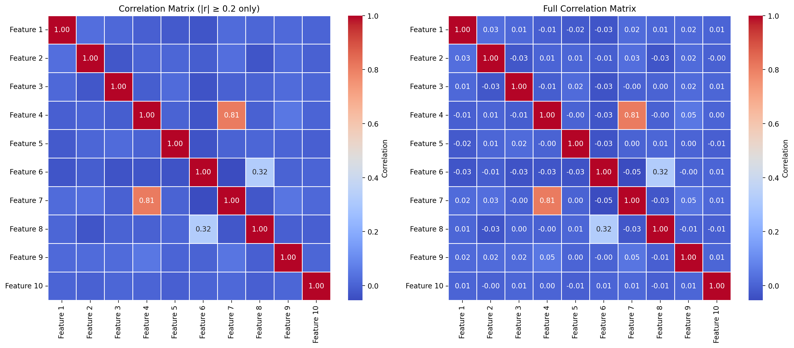
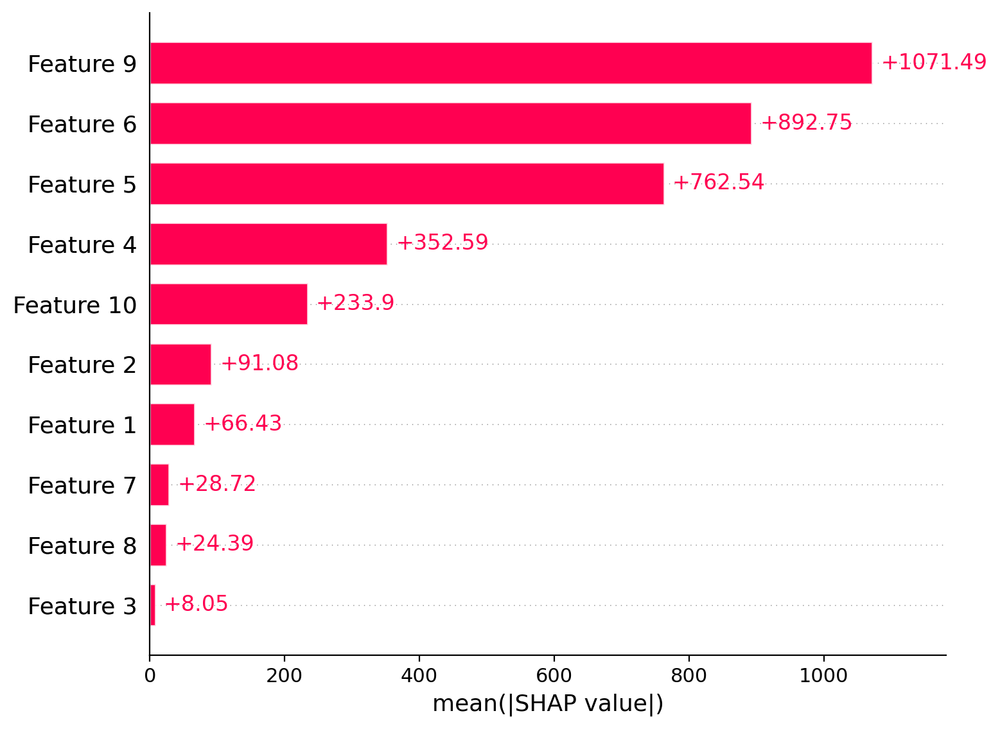
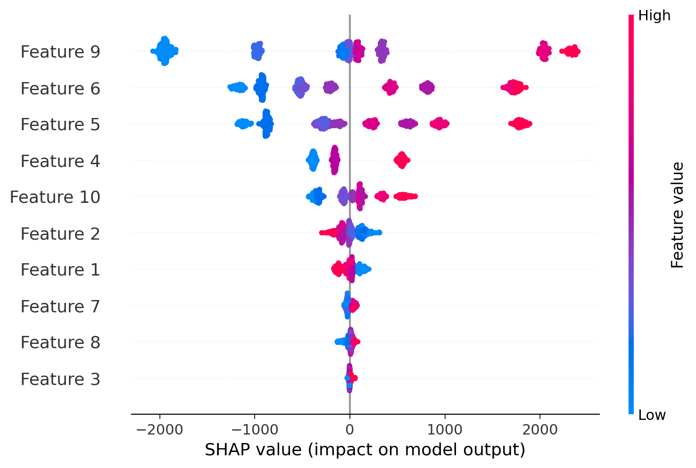

# Statistical Dependency Analysis & NPV Prediction

## Overview

An end-to-end machine learning project for analyzing statistical dependencies between geological uncertainty factors and forecasting the Net Present Value (NPV) of oil & gas investment projects.

The project combines statistical hypothesis testing, data preprocessing, machine learning, hyperparameter optimization, and model interpretability techniques. It also provides a REST API for making predictions using a trained LightGBM model.

The application is containerized with Docker and supports automated API testing.

## Problem Statement

Oil & gas investment project valuation involves multiple geological uncertainty factors that may influence the expected economic value of a project.

The objective is to analyze relationships between these factors and develop machine learning models capable of predicting project NPV.

### Input Data

- Training and control datasets
- 10 categorical geological uncertainty factors (`Feature 1`–`Feature 10`)
- Target variable: Net Present Value (`NPV`)

The categorical features represent probabilistic project scenarios using petroleum industry classifications such as `P10`, `P50`, `P90`, `P10P50`, and `P50P90`.

### Objectives

- Analyze dependencies between geological factors
- Identify statistically significant relationships
- Prepare and encode categorical input features
- Develop and compare NPV prediction models
- Optimize model hyperparameters
- Interpret model predictions and feature influence
- Provide a prediction interface through a REST API

## Methodology

### 1. Data Preprocessing

- Missing value handling
- Ordinal encoding of probabilistic geological categories
- Training and control dataset preparation
- Feature preprocessing for model training and inference

### 2. Statistical Dependency Analysis

I test statistical hypotheses of independence between each pair of categorical features using the Chi-square test.

**Significance level:** α = 0.05

The analysis includes:

- Pairwise Chi-square tests of independence
- Evaluation of 45 feature pairs
- Identification of statistically significant dependencies
- Assessment of relationships between geological uncertainty factors

**Results:**
- 45 feature pairs evaluated
- 4 statistically significant dependencies identified

#### Correlation Matrix

A correlation matrix is used to visualize relationships between geological features and identify potential patterns in the dataset.



### 3. Machine Learning Models

The following machine learning approaches were implemented and evaluated:

- Linear Regression
- Random Forest Regressor
- XGBoost Regressor
- LightGBM Regressor
- Multi-Layer Perceptron (MLP)

### 4. Hyperparameter Optimization

- GridSearchCV
- RandomizedSearchCV
- Cross-validation
- Hyperparameter tuning for ensemble models

### 5. Model Interpretability

- Feature Importance
- SHAP values
- SHAP Bar plots
- SHAP Beeswarm plots

## Machine Learning Results

Eight model configurations were evaluated using the control dataset.

The models were compared using three regression metrics:

- **R²** — coefficient of determination
- **MAE** — Mean Absolute Error
- **RMSE** — Root Mean Squared Error

### Model Performance Comparison

| Model | R² | MAE | RMSE |
|---|---:|---:|---:|
| Linear Regression | 0.8473 | 692.90 | 850.85 |
| Random Forest | 0.9353 | 425.12 | 553.87 |
| Random Forest Tuned | 0.9264 | 465.20 | 590.61 |
| XGBoost | **0.9664** | 293.93 | 399.09 |
| XGBoost Tuned | 0.9664 | 294.25 | 399.12 |
| LightGBM | 0.9658 | **291.64** | 402.91 |
| LightGBM Tuned | 0.9660 | 291.66 | 401.31 |
| MLP | 0.8606 | 604.98 | 813.08 |

### Key Findings

- XGBoost achieved the highest R² score of 0.9664.
- LightGBM achieved the lowest MAE of 291.64.
- Gradient boosting models demonstrated the strongest overall predictive performance.
- Hyperparameter tuning did not consistently improve performance across all model configurations.
- The `lightgbm_tuned` model was selected for API deployment.

The detailed evaluation results are available in [`reports/model_evaluation.csv`](reports/model_evaluation.csv).


## Model Interpretability & SHAP Analysis

Model interpretability is an important aspect of machine learning applications in oil & gas investment analysis. Beyond predictive accuracy, understanding the factors influencing NPV predictions helps support transparent and informed investment decisions.

To interpret model behavior and investigate the contribution of geological uncertainty factors, **SHAP (SHapley Additive exPlanations)** was used.

### SHAP Analysis

SHAP values quantify the contribution of individual features to model predictions based on cooperative game theory.

The analysis provides insights into:
- The relative importance of geological features
- The direction and magnitude of each feature's impact on predicted NPV
- How individual geological scenarios influence model predictions
- The contribution of features to individual predictions

### Global Feature Importance — SHAP Bar Plot

The SHAP Bar Plot summarizes the mean absolute SHAP values across the dataset, ranking geological factors according to their overall contribution to model predictions.



### SHAP Summary — Beeswarm Plot

The SHAP Beeswarm Plot provides a more detailed view of feature contributions across individual observations.

It illustrates:
- The distribution of SHAP values for each feature
- The relative impact of geological factors on NPV predictions
- How different feature values are associated with positive or negative contributions to model output



### Business Value

SHAP-based interpretability helps connect machine learning predictions with domain-specific investment analysis.

It enables analysts to:
- Identify the geological factors that contribute most to predicted project value
- Understand why a model produces a particular NPV estimate
- Examine the direction of feature contributions
- Support more transparent and explainable investment screening

By combining predictive performance with SHAP-based explanations, the project aims to make machine learning outputs more interpretable and useful for oil & gas investment decision-making.


## Model Deployment

The project includes a REST API built with **FastAPI**.

The API uses the trained `lightgbm_tuned` model to predict NPV based on 10 categorical geological features.

### API Endpoints

| Method | Endpoint | Description |
|---|---|---|
| GET | `/health` | Checks API availability and model status |
| POST | `/predict` | Returns an NPV prediction |

Interactive API documentation is available through Swagger UI at:

`http://localhost:8000/docs`

### Example Prediction Request

```json
{
  "Feature 1": "P50P50",
  "Feature 2": "P90P90",
  "Feature 3": "P10P50",
  "Feature 4": "P50",
  "Feature 5": "P90",
  "Feature 6": "P10",
  "Feature 7": "P50P10",
  "Feature 8": "P10P10",
  "Feature 9": "P90P50",
  "Feature 10": "P50P90"
}
```

Example response:

```json
{
  "predicted_npv": 2269.520444393398,
  "model": "lightgbm_tuned"
}
```

## Docker Deployment

The API is containerized using Docker.

Docker Compose is used to simplify application startup and management.

### Run the API

```bash
docker compose up -d --build
```

The API will be available at:

`http://localhost:8000`

Swagger documentation:

`http://localhost:8000/docs`

### Check Application Status

```bash
docker compose ps
```

### View Application Logs

```bash
docker compose logs
```

### Stop the Application

```bash
docker compose down
```

### Run Tests in Docker

The project uses a separate Docker build stage for testing.

```bash
docker compose --profile test run --build --rm test
```

## Testing

Automated API tests are implemented using `pytest` and FastAPI TestClient.

The test suite covers:

- Health check endpoint
- NPV prediction endpoint
- Consistency between API predictions and direct model predictions
- Validation of missing input features
- Validation of additional input features

**Test results:** 5 tests passed successfully in the Docker environment.

Run tests locally:

```bash
python -m pytest tests/test_api.py -v
```

## Technologies

**Programming Language**
- Python

**Data Analysis**
- Pandas
- NumPy
- SciPy

**Machine Learning**
- Scikit-learn
- XGBoost
- LightGBM

**Model Interpretability**
- SHAP

**Data Visualization**
- Matplotlib
- Seaborn

**API & Deployment**
- FastAPI
- Pydantic
- Uvicorn
- Docker
- Docker Compose

**Testing**
- Pytest
- HTTPX

## Repository Structure

```text
statistical-dependency-analysis/
│
├── app/
│   ├── __init__.py
│   ├── main.py
│   └── schemas.py
│
├── data/
│   └── Task_1.xlsx
│
├── models/
│   ├── lightgbm_tuned.joblib
│   ├── lightgbm.joblib
│   ├── linear_regression.joblib
│   ├── mlp.joblib
│   ├── mlp_scaler.joblib
│   ├── random_forest.joblib
│   ├── random_forest_tuned.joblib
│   ├── xgboost.joblib
│   └── xgboost_tuned.joblib
│
├── reports/
│   ├── model_evaluation.csv
│   └── correlation_matrix.png
│
├── src/
│   └── npv_prediction/
│       ├── __init__.py
│       ├── data.py
│       ├── preprocessing.py
│       ├── train.py
│       ├── evaluate.py
│       └── predict.py
│
├── tests/
│   └── test_api.py
│
├── Dockerfile
├── docker-compose.yml
├── .dockerignore
├── requirements.txt
├── requirements-api.txt
├── requirements-test.txt
├── run_training.py
└── README.md
```

## Key Outcome

The project demonstrates an end-to-end machine learning workflow for oil & gas investment analysis, from statistical dependency assessment and model development to API-based inference and Docker deployment.

It combines predictive modeling with model interpretability and provides a reproducible, containerized interface for NPV forecasting.